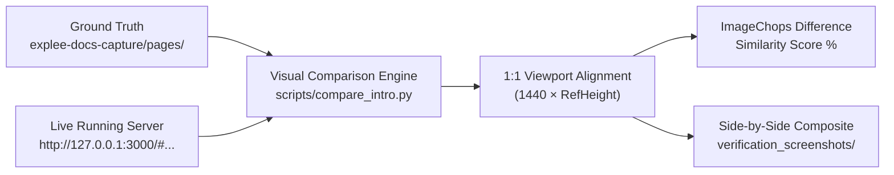

# Documentation Visual Comparison Workflow

This document provides a standard operating procedure for verifying the visual fidelity of cloned documentation pages against reference Chromium screenshots captured from the original documentation.

---

## 1. Architecture Overview

The verification workflow compares the live, running application against the static ground truth captured during the crawling phase:



### Components
1. **Reference PNGs**: Located in [`explee-docs-capture/pages/<index>-<slug>/full-page.png`](../explee-docs-capture/pages/). Each image was captured at `width: 1440` with an exact height computed from the rendered endpoint section.
2. **Live Build**: Vite development server running on `http://127.0.0.1:3000`.
3. **Endpoint Catalog**: [`src/data/endpointsData.json`](../src/data/endpointsData.json) containing route hashes, HTTP methods, paths, parameters, paragraphs, and responses.
4. **Comparison Runner**: [`scripts/compare_intro.py`](../scripts/compare_intro.py).

---

## 2. Prerequisites & Environment

- **Running Server**: Ensure the Vite dev server is running on port 3000:
  ```powershell
  npm run dev
  # Default command: vite --port 3000 --host 127.0.0.1
  ```
- **Python Dependencies**:
  ```powershell
  pip install playwright pillow
  playwright install chromium
  ```
- **Local Chrome Executable**:
  `C:\Program Files\Google\Chrome\Application\chrome.exe` (or default Playwright Chromium).

---

## 3. Step-by-Step Comparison Procedure

### Step 1: Identify the Target Route
Find the route in [`src/data/endpointsData.json`](../src/data/endpointsData.json) or [`explee-docs-capture/pages/`](../explee-docs-capture/pages/):

- **Example Route**: `"Get campaign definition"`
- **Folder**: `005-get-campaign-definition`
- **Reference Image**: `explee-docs-capture/pages/005-get-campaign-definition/full-page.png`
- **Hash Route**: `#tag/autogtm/GET/public/api/v1/autogtm/campaigns/{campaign_id}`

### Step 2: Match Viewport Dimensions 1:1
Always inspect the reference PNG height before taking the clone screenshot to ensure identical canvas sizes:

```python
from PIL import Image

ref_img = Image.open('explee-docs-capture/pages/005-get-campaign-definition/full-page.png')
ref_w, ref_h = ref_img.size # e.g. 1440 x 1302

# Set Playwright viewport to match exactly:
page = browser.new_page(viewport={'width': 1440, 'height': ref_h}, device_scale_factor=1)
```

### Step 3: Navigate and Capture
Navigate directly to the hash route on the local server:

```python
target_url = f'http://127.0.0.1:3000/{route_hash}'
page.goto(target_url, wait_until='networkidle')
page.wait_for_timeout(1500) # Allow DOM, syntax highlighting, and sidebar highlighting to stabilize

page.screenshot(path='verification_screenshots/cloned_page.png')
```

### Step 4: Compute Visual Similarity
Compute the pixel-by-pixel difference using Pillow's `ImageChops.difference`:

```python
from PIL import ImageChops

def calculate_similarity(img1, img2):
    w = min(img1.width, img2.width)
    h = min(img1.height, img2.height)
    c1 = img1.crop((0, 0, w, h)).convert('RGB')
    c2 = img2.crop((0, 0, w, h)).convert('RGB')
    diff = ImageChops.difference(c1, c2)
    stat = diff.getdata()
    total_diff = sum(sum(pixel) for pixel in stat)
    max_diff = w * h * 3 * 255
    similarity = (1.0 - (total_diff / max_diff)) * 100.0
    return similarity
```

### Step 5: Generate Side-by-Side Composite
Construct a combined image with clear reference and clone headers:

```python
from PIL import ImageDraw

header_h = 40
combo = Image.new('RGB', (ref_w + clone_w, ref_h + header_h), color=(240, 240, 240))
draw = ImageDraw.Draw(combo)

# Header styling
draw.rectangle([(0, 0), (ref_w, header_h)], fill=(230, 235, 240))
draw.rectangle([(ref_w, 0), (ref_w + clone_w, header_h)], fill=(225, 245, 235))
draw.text((20, 12), f"REFERENCE: {page_name} (Saved PNG)", fill=(30, 30, 30))
draw.text((ref_w + 20, 12), f"CLONE: {page_name} (Running Server) - Similarity: {similarity:.1f}%", fill=(0, 100, 80))

# Paste screenshots
combo.paste(ref_img, (0, header_h))
combo.paste(clone_img, (ref_w, header_h))
combo.save(f"verification_screenshots/compare_{slug}_side_by_side.png")
```

---

## 4. Reusable Script Reference (`scripts/compare_intro.py`)

The comparison script [`scripts/compare_intro.py`](../scripts/compare_intro.py) is pre-configured to execute single-page or batch comparisons.

### Running Single-Page Comparison
```powershell
python scripts/compare_intro.py --route "005-get-campaign-definition"
```
Or by label:
```powershell
python scripts/compare_intro.py --route "Get campaign definition"
```

### Running Section Batch Comparison
```powershell
python scripts/compare_intro.py --tag search
python scripts/compare_intro.py --tag contact
python scripts/compare_intro.py --tag autogtm
```

### Running Complete Suite
```powershell
python scripts/compare_intro.py --all
```

---

## 5. Visual Quality Checklist

When reviewing the side-by-side composite, verify the following visual details:

| Component | Target Appearance | Common Issue & Fix |
| :--- | :--- | :--- |
| **H1 Heading** | 24px semi-bold, leading 34.8px, `#1b1b1b` | Check font size and margin in [EndpointContent.jsx](../src/components/docs/EndpointContent.jsx). |
| **Top Toolbar** | `Auth Required` + `Copy as Markdown` right-aligned | Must sit on the same vertical baseline as the title. |
| **Paragraphs** | Individual `<p>` tags with leading 22px | Ensure `paragraphs[0]` (combined text) is not rendered twice. |
| **Prefixes** | Bold `Who it targets:`, `What it says:`, etc. | Handled via `renderTextWithCode` prefix regex. |
| **Parameters** | Labeled **Path Parameters** vs **Query Parameters** | Parameter name checked against `{name}` in endpoint path. |
| **Status Codes** | Status chips (`200`, `401`, `404`) with `+` expandable icon | Must match codes defined in `endpoint.responses`. |
| **cURL Terminal** | Dark background (`#1e2029`), `Shell Curl ∨`, path evaluated | Template braces `{param}` should be replaced with sample ID `1`. |
| **Response Card** | Horizontal status tabs with `200` active, syntax JSON | Matches response schema for the active status code. |
| **Sidebar** | Group accordion open, active item highlighted `#ecf8f6` | Active item styled with `#009485` text and method badge. |

---

## 6. Directory Structure Reference

```
adventurous-archimedes/
├── explee-docs-capture/
│   ├── all-pages-master.json           # Crawled metadata for all 64 routes
│   └── pages/
│       ├── 001-introduction/full-page.png
│       ├── 005-get-campaign-definition/full-page.png
│       └── ...
├── verification_screenshots/
│   ├── compare_intro_side_by_side.png
│   ├── compare_get_definition_side_by_side.png
│   ├── compare_search_companies_side_by_side.png
│   └── ...
├── src/
│   ├── data/
│   │   └── endpointsData.json          # Master endpoint catalog
│   └── components/docs/
│       ├── ApiDocs.jsx                 # Routing and layout container
│       ├── DocsSidebar.jsx             # Tree navigation with method badges
│       └── EndpointContent.jsx         # Two-column documentation view
└── scripts/
    ├── inspect_docs.py                 # Endpoint parser and JSON generator
    └── compare_intro.py                # Automated visual comparison runner
```
